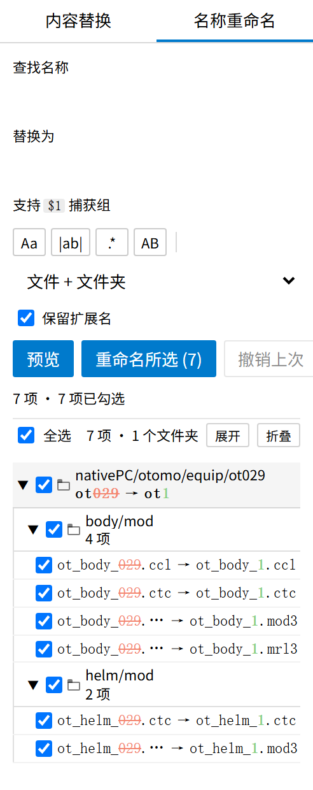

# Search & Rename

**在资源管理器里右键，按名称批量重命名文件和文件夹。**
树形预览、冲突拦截、一次撤销。

VSCode 自带的重命名只能一个个来，原生搜索的「替换」只改文件**内容**、不碰**名字**。
这个扩展补上中间那块：把 `Buttom` → `Button` 这种改名，一次性、可预览、可撤销地做完。

> 声明：本插件的代码完全由 AI 生成。虽然功能经过测试，但仍可能存在未覆盖的边界情况，请谨慎使用。

---

## 安装

### 从 GitHub Releases 下载（推荐）

1. 打开 **[最新 Release](https://github.com/YukiSuoug/search-and-rename/releases/latest)**，
   在 Assets 里下载 `search-and-rename-x.y.z.vsix`；
2. 在 VSCode 里按 `Ctrl+Shift+X` 打开扩展面板 → 点右上角 `…` → **从 VSIX 安装…** → 选中刚下载的文件；
3. 装完若没立刻生效，按 `Ctrl+Shift+P` 执行 `Developer: Reload Window`。

也可以用命令行装（在 `.vsix` 所在目录执行）：

`code --install-extension search-and-rename-0.1.0.vsix`

### 从扩展市场安装

在 VSCode 扩展面板搜索 **Search & Rename**。
> 若搜不到，说明尚未上架，用上面的 VSIX 方式即可。

---

## 设计取向

四条取舍决定了它长成现在这样：

| 取向 | 具体做法 |
|---|---|
| **只做一件事** | 一条命令 + 一个预览列表。没有编号 / 插入 / 删除 / 大小写模板这些额外规则 |
| **冲突不隐藏** | 目标名被占用时明确列出并要求你决定，**不会自作主张加序号** |
| **先看清再动手** | 按目录分组的树形预览，每行都是 `旧名 → 新名`，回车前每一条都看得见 |
| **随时能反悔** | 单次提交，一次 `Ctrl+Z` 全部回滚；另保留最近 20 次操作日志可逐次回滚 |

---

## 预览长什么样



按目录分组，**每个目录只出现一次**；被改名的文件夹成为可折叠分组头，它整棵子树都会跟着移动：

```
▼ 📁 nativePC/otomo/equip/ot029   ot{029} → ot{1}
  ▼ 📁 body/mod/                  [目录分组 · 4 项]
      📄 ot_body_{029}.ccl → ot_body_{1}.ccl
      📄 ot_body_{029}.ctc → ot_body_{1}.ctc
      📄 ot_body_{029}.…   → ot_body_{1}.mod3     ← 旧名让位，新名完整
      📄 ot_body_{029}.…   → ot_body_{1}.mrl3
```

> 红字删除线 = 被替换掉的部分，绿字 = 替换后的结果。

**一行放不下时，优先保住新名。** 旧名和新名里，只有新名是你要确认并提交的东西 ——
所以空间不够时旧名先省略，新名始终完整可读。悬停任意一行可看完整相对路径。

---

## 用起来

**在左侧资源管理器的文件/文件夹上右键 → 「批量重命名名称…」**

1. 输入「查找名称」；
2. 输入「替换为」（支持 `$1` 捕获组、`$&` 整体匹配、`$$` 字面 `$`）；
3. 勾选匹配选项（区分大小写 / 全字匹配 / 正则 / 保留大小写 / 只匹配文件或文件夹）；
4. 若右键的是文件夹，选择**是否连它自身一起改名**；
5. 在预览里勾选要执行的项，回车。

**作用范围就是你选中的东西** —— 右键一个文件夹，就只扫这棵子树，不会去动整个工作区。

| 入口 | 位置 | 说明 |
|---|---|---|
| **右键菜单** ⭐ | 资源管理器里右键 | 主入口，范围 = 选中项 |
| 命令面板 | `批量重命名名称…` | 不选中任何项时 = 整个工作区 |
| Activity Bar 面板 | `Ctrl+Alt+P` | 次要入口，带完整预览树的对照视图 |
| 快捷键 | `Ctrl+Alt+R` | 等同于命令面板 |

> ⚠️ **关于 `Ctrl+Alt+Shift+R`**：这个组合被 VSCode 内置的「转到编辑器中的符号」
> (`workbench.action.showAllSymbols`) 占着。本扩展为了让 `Ctrl+Alt+Shift+R` 也能用，
> **解绑了那个内置快捷键**。如果你不接受这个改动，删掉 `keybindings.json` 里
> 带 `-workbench.action.showAllSymbols` 的那一条即可，或用不冲突的 `Ctrl+Alt+P`。

---

## 特性

- **匹配范围**：文件 + 文件夹 / 仅文件 / 仅文件夹
- **匹配选项**：区分大小写、全字匹配、正则表达式、保留大小写
- **保留扩展名**：默认只改主体，`util.test.ts` → `utils.test.ts`
- **冲突检测**：目标已存在 / 批次内撞名 / 仅大小写变化 / 非法名称 —— 冲突项默认不勾选
- **树形预览**：按目录分组，可折叠；勾选分组头联动整棵子树（子项部分勾选时父级显示半选）
- **安全执行**：先深后浅排序；单次提交；打开中的编辑器自动跟随；脏缓冲区保留
- **整体撤销**：一次 `Ctrl+Z` 回滚全部；另保留最近 20 次批量操作日志，可逐次回滚
- **进度与取消**：长任务有进度提示，可随时中止

---

## 常用配方

> 默认「保留扩展名」是**开**的 —— 查找/替换作用在**主体**上（不含 `.ts` 这类后缀），
> 扩展名自动保留。所以「加前缀」直接写 `^(.+)$` → `v2_$1` 就行，不用管后缀。

| 想要的效果 | 查找（勾选「使用正则表达式」） | 替换为 |
|---|---|---|
| 加前缀 | `^(.+)$` | `v2_$1` |
| 加后缀 | `^(.+)$` | `$1_old` |
| 去掉前缀 `old_` | `^old_(.+)$` | `$1` |
| 编号改成语义名 | `^img_(\d+)$` | `photo_$1` |
| 压掉重复的一段 | `^(.+)-(.+)-(.+)$` | `$1_$3` |
| **换扩展名**（如 `.ts` → `.tsx`） | `^(.*)$` → 建议直接**关掉「保留扩展名」**，再用 `\.ts$` → `.tsx` | — |

替换串里可用的占位符（走 JavaScript 引擎，与 VSCode 搜索框的写法不同）：

| 写法 | 含义 |
|---|---|
| `$1` … `$99` | 第 N 个捕获组 |
| `$<name>` | 命名捕获组 `(?<name>…)` |
| `$&` | 整个匹配到的文本 |
| `` $` `` / `$'` | 匹配**之前** / **之后**的文本 |
| `$$` | 一个字面量 `$` |

> ⚠️ **不支持 `\1`**（会被当字面量）。VSCode 原生搜索框用 `\1`，这里是 `$1`。

> 💡 「保留大小写」是**逐字符**对齐匹配串的大小写形状，不是「整串变大写」：
> 匹配 `Buttom` + 替换 `button` → 得到 `Button`（只有首字母跟着大写）。

---

### 安全设计

- **不覆盖已存在的文件**：目标名已占用时会标为冲突并要求你显式决定，绝不静默覆盖。
- **不做隐式改名**：不会背着你加序号或改扩展名。
- **执行前守卫**：只读 / 虚拟文件系统会直接拦下；大批量会二次确认。
- **可回滚**：所有改动走 VSCode 的编辑事务，一次撤销回到原状。

---

## 隐私

**这个扩展不联网。** 代码里没有任何网络请求，也没有 `dependencies`（零运行时依赖）。
它只做一件事：读写你本地的文件系统。

---

## 设置

| 键 | 默认 | 说明 |
|---|---|---|
| `searchAndRename.matchTarget` | `both` | 匹配范围：文件+文件夹 / 仅文件 / 仅文件夹 |
| `searchAndRename.preserveExtension` | `true` | 保留扩展名，只替换主体 |
| `searchAndRename.respectExclude` | `true` | 遵循 `files.exclude` / `search.exclude` |
| `searchAndRename.extraExclude` | `["**/node_modules/**", "**/.git/**", …]` | 额外排除的 glob |
| `searchAndRename.confirmThreshold` | `15` | 超过此数量要求二次确认 |
| `searchAndRename.maxEntries` | `200000` | 扫描条目上限，超出则中止并提示缩小范围 |
| `searchAndRename.defaultCaseSensitive` | `false` | 默认是否区分大小写 |

### 命令

| 命令 | 说明 |
|---|---|
| `Search & Rename: 批量重命名名称…` | 主流程（右键菜单入口） |
| `Search & Rename: 打开重命名面板` | 打开 Activity Bar 面板 |
| `Search & Rename: 刷新预览` | 重新扫描 |
| `Search & Rename: 执行重命名` | 执行当前无冲突项 |
| `Search & Rename: 撤销上次批量重命名` | 回滚最近一次 |

---

## 已知边界

- **不跟随符号链接**（避免环与越界）。
- 大小写不敏感的文件系统上做「仅大小写改名」时，会提示 git 可能不识别（建议用 `git mv`）。
- 虚拟 / 只读文件系统无法重命名（会提前拦下）。
- 超大仓库达到条目上限会中止并提示缩小范围。

---

## 反馈

遇到问题或有想法，欢迎提 issue：
<https://github.com/YukiSuoug/search-and-rename/issues>

---

## 开发者

架构、测试（含真浏览器布局检查）、打包发布流程、以及 21 条踩坑记录 →
[`docs/DEVNOTES.md`](docs/DEVNOTES.md)

MIT License.
